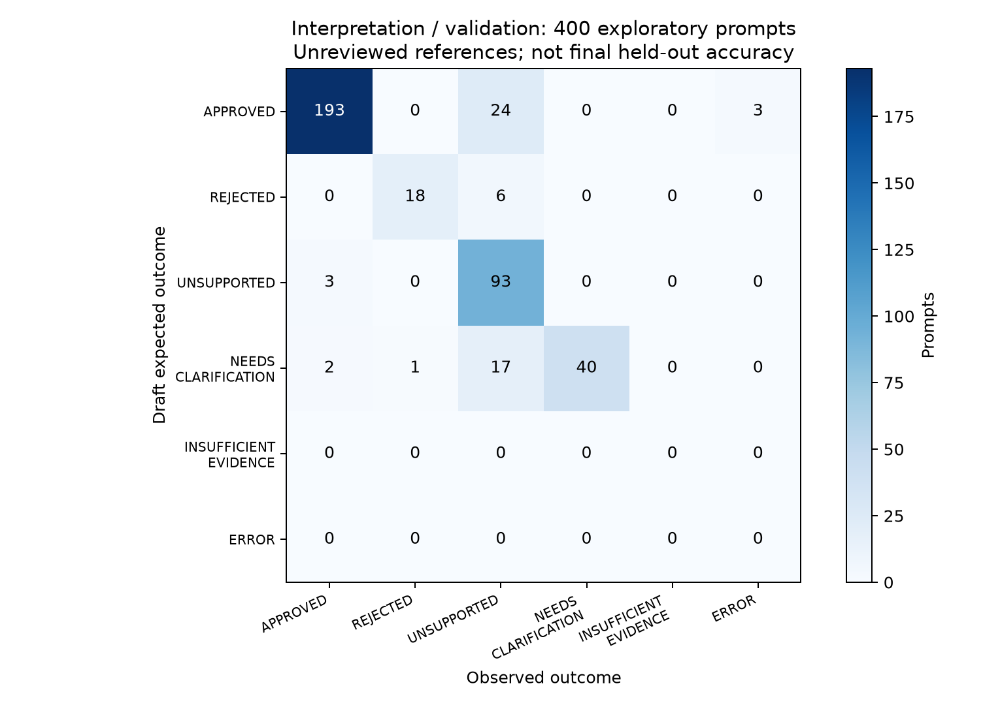
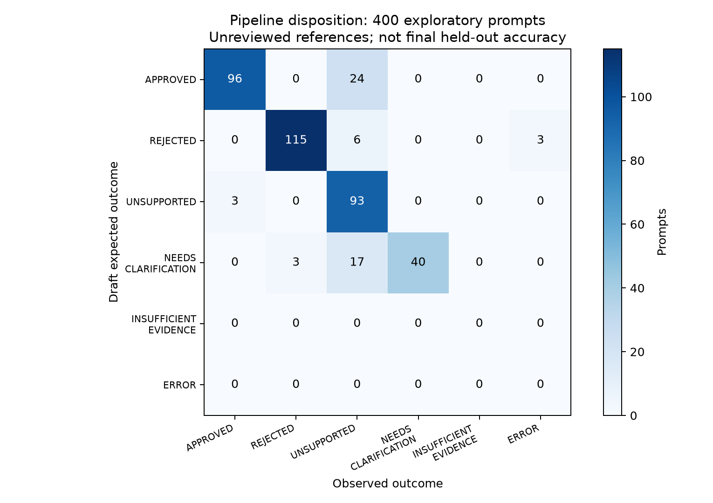
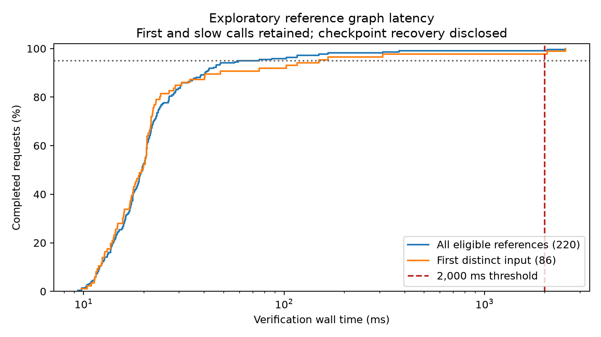

# Exploratory 400-prompt evaluation — started 19 October 2026

**Status: complete. Saved model/pipeline results: 400/400.**
This is one exploratory pass over the assistant-drafted proposal. It is not the
final held-out A–C evaluation. The researcher requested execution while reference
review and family-independence checks remained pending. All reference labels were
preserved and snapshotted before execution. This dataset is now exposed evaluation
material; do not describe a later rerun as a previously untouched held-out test.

Started (UTC): `2026-10-19T15:18:16.555724+00:00`.
Resumed (UTC): `['2026-10-19T15:20:19.615591+00:00', '2026-10-20T08:21:41.560852+00:00']`.
Latest checkpoint (UTC): `2026-10-20T08:41:39.347907+00:00`.
The run stopped after 294 cases on 19 October when the daily provider token
quota was exhausted, and resumed on 20 October from case 295. Previously saved
cases were not repeated. Daily-quota failure cases retained in the denominator:
`['FINAL-DRAFT-092-B', 'FINAL-DRAFT-093-B', 'FINAL-DRAFT-094-B']`. Segment checkpoints and graph snapshots are preserved.

## Scope and method

Groq model `openai/gpt-oss-20b`, temperature 0, reasoning effort low; Sepolia
11155111. The unchanged parser is called once logically per prompt, with its
normal retry behavior. Its recorded resolution is reused in the unchanged pipeline;
there is no second model call for C. Primary formulations run first, followed by
alternate formulations. Temporal ordering can confound a wording comparison.

Independent reference-intent graph checks precede extraction and cover 220 eligible
prompts, 110 nominal primary families and 86 distinct graph inputs. The remaining
180 prompts are ineligible by the draft validation reference; their reasons are
saved in `reference_graph_plan.json`. Graph results are not gated by LLM success.

No wallet checks, graph mutations, policy renewal, signing or transaction submission
are part of this run. Graph approval is not wallet readiness or execution success.

## Interpretation and pipeline conformance

| Population | Prompts | Validation status matches | Pipeline status matches | Joint draft matches | Provider/parser errors | Draft pipeline approval flags |
|---|---|---|---|---|---|---|
| All saved prompts | 400 | 344 | 344 | 336 | 3 | 3 |
| Primary formulations | 200 | 183 | 183 | 180 | 0 | 2 |

| Category | Prompts | A status matches | C status matches | Joint draft matches |
|---|---|---|---|---|
| incomplete_or_ambiguous | 60 | 40 | 40 | 32 |
| invalid_parameters_or_conditions | 60 | 54 | 54 | 54 |
| known_entities_invalid_relationship | 80 | 77 | 77 | 77 |
| supported_aave | 60 | 60 | 60 | 60 |
| supported_uniswap | 60 | 36 | 36 | 36 |
| unknown_or_unsupported | 80 | 77 | 77 | 77 |

“Joint draft match” requires both stage dispositions and the specified normalized
fields/missing fields for APPROVED or NEEDS_CLARIFICATION references. For other
dispositions it measures disposition conformance only, not exhaustive understanding
of all conditions. It must not be called independently established end-to-end
accuracy. Detailed raw outputs, normalized candidates, field comparisons and
graph calls are in `results.json`; `case_summary.csv` provides a flat table.

Valid JSON objects: 397/400.
Strict prompt-shape conformance: 397/400.
Returned normalized candidates: 238; omitted candidates
after a non-approval are not automatically schema errors. The shape audit checks
the advertised extraction format without modifying the production parser.

Observed provider outer attempts: 403;
successful responses: 397; failed outer
attempts: 6. SDK-internal HTTP retries
are not individually counted. Recorded tokens: {'prompt_tokens': 422669, 'completion_tokens': 47860, 'total_tokens': 470529}.
This is not a monetary billing statement. All failures remain visible.

## Independent graph results and R6

Recorded graph calls: 220; draft decision matches:
220; selected snapshot evidence matches:
220; operational failures: 0.
The draft and current snapshot dispositions were compared before verifier calls.
Snapshot conformance is not independent protocol truth.

| Draft graph reference | Observed decision | Calls |
|---|---|---|
| APPROVED | APPROVED | 120 |
| REJECTED | REJECTED | 100 |

| Graph population | Calls | ≤2,000 ms | Percentage | p50 ms | p95 ms | Max ms |
|---|---|---|---|---|---|---|
| All eligible prompt references | 220 | 218 | 99.090909% | 19.6 | 59.138 | 2532.215 |
| Primary eligible references | 110 | 108 | 98.181818% | 20.672 | 149.339 | 2532.215 |
| First distinct input | 86 | 84 | 97.674419% | 19.44 | 149.339 | 2532.215 |

Timings include the verifier and database work, excluding LLM and wallet time.
First and slow calls are retained; no cache flush was performed. Quantiles use
nearest rank. A Windows checkpoint replacement failure interrupted the graph
phase after 100 measurements. All 100 were recovered intact from the checkpoint
and its fully written temporary file; none was rerun or discarded. The remaining
graph calls resumed after a process restart, which affects connection/cache state.
Recovery artifacts and harness hashes are retained. Production code and labels
were not altered to improve results.

## Alternative wording and diagnostics

Completed pairs: 200/200. Same A status:
163; same normalized resolution:
159; same C status:
163; both wordings jointly match the draft:
149. Matching outcomes may both be wrong.
No three-pass model repeatability experiment was performed.

Diagnostic counts: {'pipeline_approval_against_nonapproval_draft_reference': 3, 'validation_disposition_mismatch_requires_reference_review': 50, 'interpreted_field_mismatch': 8, 'provider_or_parser_failure': 3}.
Flagged interpretation approvals: 5;
non-operational graph containment among recorded flags:
2. Containment is not correct interpretation.
Review every flag in `approval_flags_for_review.json` and other discrepancies in
`diagnostics.csv`. These labels are not independently adjudicated safety failures.

### Observed causes and reference-review priorities

- 24 supported-swap draft cases were blocked with
  `unrecognized_slippage_condition`; raw model slippage matched the draft in
  24 of these cases.
  The phrase "slippage must not exceed" is absent from the deterministic
  recognition patterns in `llm/request_constraints.py`. This is a validation
  wording limitation, not evidence that the model failed to extract that value.
- Families 127 and 128 use "add liquidity" and "remove liquidity" in an Aave
  request. The primary outputs map these to supply and withdraw, whereas the
  draft expects UNSUPPORTED. The intended meaning and labels need human
  adjudication before calling these confirmed false approvals.
- Flash-borrow prompts approved against unsupported draft references:
  `['FINAL-DRAFT-126-B']`. In FINAL-DRAFT-126-B, the raw extraction replaced "flash borrow"
  with ordinary `borrow`, and the graph approved the resulting borrow intent.
  This illustrates that relationship verification can accept a valid graph path
  after the language stage has lost an unsupported action modifier. No wallet
  operation was attempted.
- Some incomplete requests retain the clarification disposition but lose
  specified fields; other ambiguous requests become UNSUPPORTED or REJECTED.
  The diagnostics separate field loss from disposition mismatches.
- Provider quota errors are availability outcomes, not semantic extraction
  failures. They remain in the attempted-prompt denominator.

These observations do not alter code or labels. A later correction must be
evaluated as a separate version, with any reuse of these prompts disclosed.

## Validity and remaining work

The 400 prompts represent 200 declared families, not 400 independent cases. The
earlier audit found 74 families sharing development graph inputs and only 86
distinct eligible graph inputs. Synthetic templates and reverse directions can
remain dependent. No valid population confidence interval or final false-approval
hypothesis test is claimed. Final evaluation requires researcher-reviewed,
appropriately separated references and a supervisor-approved sampling plan.

Graph snapshot content unchanged: True.
Protected environment/policy files unchanged: True.
Production/evaluation code hash check: True.
Earlier thesis-report artifacts were preserved; this run is a separate supplement.

## Reproduction

Input dataset SHA-256: `db0e1f103d446124d9aa853870526c25398bb1541bd5f32183bf101461bb9ffd`.
Run parameters, timestamps, code hashes and original labels are preserved here.
Regenerate analysis without model/database calls from the repository root:

```powershell
python -B -m evaluation.analyse_exploratory_400 evaluation/exploratory_400_reports/20261019T151816Z
```

The execution command is `python -B -m evaluation.exploratory_400_runner
--allow-unreviewed --delay 8`; it makes model calls and must not be confused with
offline analysis. The immutable previous report ZIP remains unchanged.

## Figures






