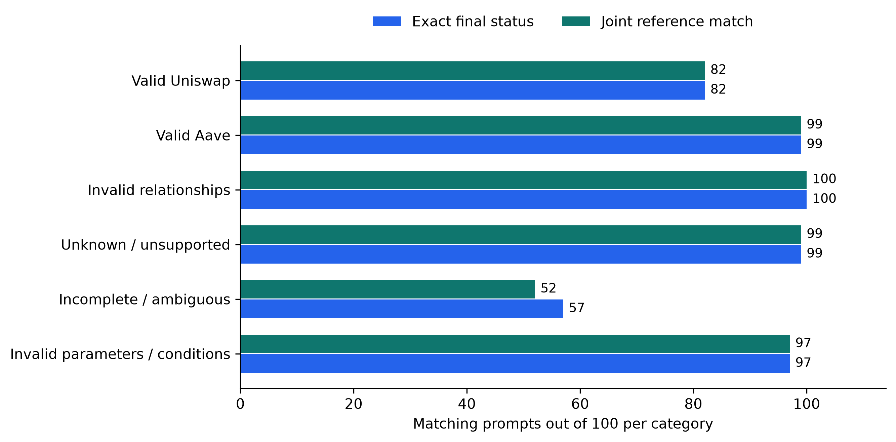
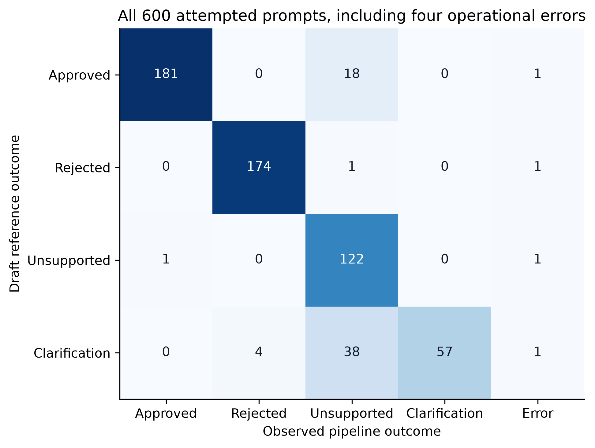
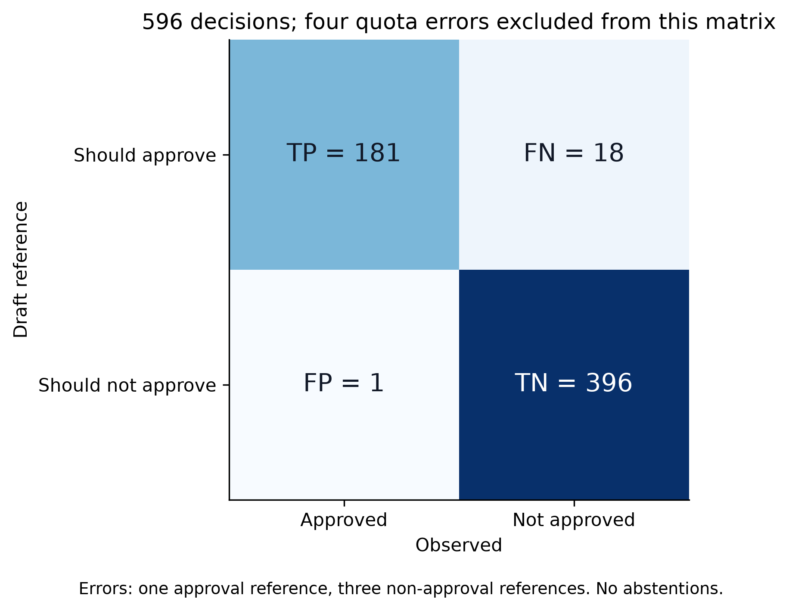
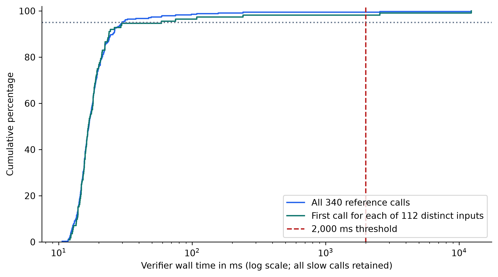
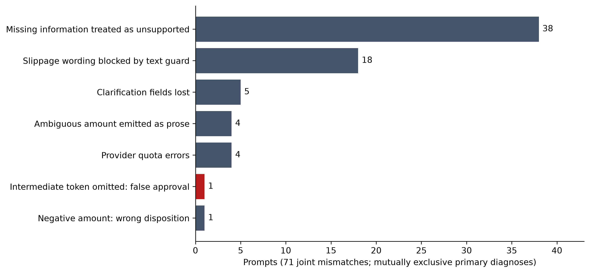
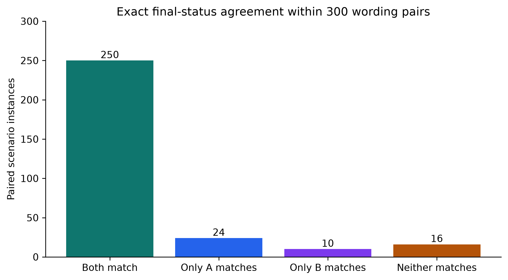

# Evaluation: balanced 600-prompt follow-up

Prepared from the completed observations on 24 October 2026. This text is suitable for adaptation into Chapter 5. Its references remain assistant-drafted and require researcher review. Execution is complete; independent reference validation is not. The historical reports remain preserved and must be read with their original dates.

## Evaluation objective and scope

The evaluation examines whether the prototype interprets a natural-language DeFi request, validates its scope and parameters, and verifies the required relationships in the admitted Neo4j knowledge graph. The implemented scope comprises Uniswap V3 ERC-20 swaps and Aave V3 supply, withdraw, borrow and repay on Ethereum Sepolia, chain ID 11155111. Groq-hosted `openai/gpt-oss-20b` performs intent extraction. Deterministic application code performs validation, and Python/Cypher queries perform graph verification. Graph verification is not performed by the language model.

Three stages are distinguished. Experiment A records extraction and validation. Experiment B passes eligible reference intents directly to the graph verifier, independently of extraction success. Experiment C evaluates the pipeline using the same recorded interpretations as A. Thus A and C are not separate model generations, and a failure before graph verification does not remove the corresponding eligible reference case from B. Wallet preparation and transaction execution are outside these experiments. An approval establishes the implemented graph relationship checks for the interpreted intent; it does not establish balances, allowances, liquidity, collateral, debt, health factor, or transaction success.

## Dataset and execution procedure

The balanced follow-up contains 300 scenario instances with two formulations each, giving 600 prompts. Each of six categories contains 50 scenario instances and 100 prompts. The prompts were authored synthetically using documented operation semantics, the local scope and the saved graph snapshot. They are not 600 sampled records from INTENT-TX-18K. Documentation supplies semantic context, rather than independently authored test queries or gold labels.

The categories cover valid swaps, valid lending requests, invalid relationships between known entities, unknown or unsupported scope, incomplete or ambiguous requests, and invalid parameters or unsupported conditions. Supported swaps use six directed token pairs represented in the admitted snapshot. Lending cases cover the four actions across nine reserves, with additional scenario variants. Amount, network wording and slippage variations increase prompt coverage without necessarily producing a new graph input.

There are 247 heuristic semantic clusters and 112 distinct eligible graph inputs. Neither 600 prompts nor 300 declared scenario instances should be described as that many statistically independent observations. The dataset was informed by development findings, including problematic slippage wording. The preparation audit reports no exact normalized overlap with 1,134 screened prior prompts, six near-text overlap flags and prior graph-input overlap for 137 eligible scenario instances. These checks do not establish absence of semantic leakage. The user accepted the dataset for execution, but item-level human review was not documented. The execution copy was locked while the original reference-review status remained pending.

One logical pass ran from 22 to 24 October 2026, finishing at 10:14 Berlin time on 24 October. The model configuration used temperature 0, low reasoning effort and a maximum of 512 completion tokens. A seeded order interleaved categories and kept each pair adjacent with randomized A/B order. Quota interruptions required resumptions. Completed observations and service errors were retained; earlier cases were not replaced with successful reruns. Of 600 logical attempts, 596 produced model responses and four ended with quota errors. Recorded outer API attempts include retries and should not be equated with prompt count; SDK-internal retries are not individually observed. All 596 successful responses were recorded as JSON objects conforming to the prompt schema, which establishes syntactic conformance rather than semantic correctness.

The admitted graph snapshot was held stable during the run. Its provenance and source/configuration fingerprints are saved with the execution artifacts. The local pool-admission policy must be distinguished from protocol membership: the implementation restricts eligible Uniswap assets using the active Aave-reserve token set or WETH. This is a local prototype policy, not an official Uniswap-to-Aave dependency. Snapshot conformance therefore does not establish coverage of all official pools or classify excluded pools as malicious.

## Metrics and denominators

Exact final-status agreement requires the observed pipeline status to equal the draft reference status. Its denominator includes all 600 attempted prompts, including errors. Joint reference agreement additionally requires validation-status agreement and the specified normalized fields and exact missing-field set to match for APPROVED and NEEDS_CLARIFICATION references. For other dispositions the implemented joint metric is disposition conformance only. It must not be presented as exhaustive preservation of every natural-language condition.

For binary analysis, positive means the request should be approved under the declared reference scope; negative means it should not be approved. A true positive is an approval when approval is expected. A false negative is a non-approval when approval is expected. A false positive is approval when a non-approval is expected. A true negative is a non-approval for a negative reference. Operational errors and evidence abstentions are reported separately. Consequently, returning UNSUPPORTED instead of NEEDS_CLARIFICATION can be a binary true negative while remaining an exact-status error.

Precision is TP/(TP+FP), recall is TP/(TP+FN), specificity is TN/(TN+FP), the false-positive rate is FP/(FP+TN), and the false-negative rate is FN/(FN+TP). Binary accuracy uses the 596 cases with decisions, while decision coverage uses all 600 attempts. These denominators are reported together to prevent errors from disappearing from the evaluation.

## Pipeline results

The pipeline matched the exact draft status for **534/600 prompts (89.00%)**. Joint reference agreement was **529/600 (88.17%)**. The difference comprises five clarification cases whose disposition matched but whose extracted fields and missing-field requests did not.

| Category | Prompts | Exact status matches | Joint matches | Operational errors |
|---|---:|---:|---:|---:|
| Valid Uniswap swaps | 100 | 82 | 82 | 0 |
| Valid Aave requests | 100 | 99 | 99 | 1 |
| Known entities, invalid relationships | 100 | 100 | 100 | 0 |
| Unknown or unsupported scope | 100 | 99 | 99 | 1 |
| Incomplete or ambiguous requests | 100 | 57 | 52 | 1 |
| Invalid parameters or unsupported conditions | 100 | 97 | 97 | 1 |
| Total | 600 | 534 | 529 | 4 |

The full confusion matrix retains all 600 attempts. The binary matrix contains TP=181, FP=1, FN=18 and TN=396. The four errors comprise one approval reference and three non-approval references. There were no evidence abstentions in this run. Decision coverage was 596/600 (99.33%). Among decisions, precision was 99.45%, recall 90.95%, specificity 99.75%, false-positive rate 0.25%, false-negative rate 9.05%, F1 95.01% and binary accuracy 96.81%.

Binary accuracy is higher than exact-status agreement because it collapses several different non-approval responses into one class. It does not imply 96.81% complete intent understanding. In particular, the incomplete category contains 99 binary true negatives but only 57 correct clarification dispositions and 52 joint matches.

## Core analysis: unknown scope and invalid relationships

The two core categories can be reported as dedicated analyses of the existing run. Their results are not additional independent experiments and should not be added again to the total sample count.

The invalid-relationship category contains 100 prompts from 50 paired scenarios. All 100 requests passed interpretation into graph verification and were rejected as expected, with no false approvals or operational errors. The scope of this result requires qualification: 32 prompts concern two assets appearing in admitted Uniswap pools but without the requested pair; 68 involve at least one asset outside the admitted pool-asset set, although the assets are known through Aave reserves. The latter tests protocol/resource association within the local snapshot, rather than exclusively testing a missing pair between two admitted swap assets. The 50 directed reference inputs are repeated across their two formulations.

The unknown-or-unsupported category contains 20 prompts each for unsupported protocols, networks and operations. All 60 received the expected UNSUPPORTED result. Another 38 concern assets absent from the saved Aave reserves: 37 were rejected and one encountered a quota error. Two native-asset boundary prompts were rejected as expected. Thus this category achieved 99/100 exact matches, with zero false approvals and one operational error. Absence from the admitted snapshot does not establish that an asset is nonexistent or malicious. Unsupported operations and networks are principally handled by validation; the category is not a claim that all unknown-scope decisions were made by graph traversal.

## Independent reference-intent graph evaluation and latency

Experiment B evaluated 340 reference-intent calls from 170 paired scenario instances, covering 112 distinct graph inputs. All **340/340** matched the draft snapshot decision and selected evidence checks, with no recorded operational failures. The graph inputs include valid operations and expected rejections even where extraction failed. Experiment C separately made 321 graph calls from actual interpretations. These counts describe different workloads; 340 graph calls should not be reported as 340 additional natural-language prompts or unique relationships.

The selected evidence metric is limited. For approvals it checks specified route or contract/function fields against the reference paths. For non-approvals it checks absence of a verified address. It does not test whether every rejection identifies the exact missing edge, nor whether every possible route is returned. Therefore 340 selected-evidence matches must not be described as 340 complete explanatory traces.

| Graph population | Calls | Within 2 seconds | Percentage | Median ms | p95 ms | Maximum ms |
|---|---:|---:|---:|---:|---:|---:|
| All reference calls | 340 | 338 | 99.41% | 16.815 | 29.827 | 12,327.911 |
| First occurrence of each distinct input | 112 | 110 | 98.21% | 16.684 | 58.905 | 12,327.911 |

Quantiles use the nearest-rank method. The two slow calls were BAL600-027-A at 12,327.911 ms and BAL600-192-B at 2,549.117 ms. All first and slow requests remain included. The first occurrence of an input is not necessarily a cold-database measurement. The observed proportions meet R6's threshold of at least 95% within two seconds on this workload. This is a descriptive result for the recorded snapshot and environment, not a general latency guarantee. Measurements surround the verifier entry point and exclude LLM and wallet time. The multi-day run duration is not a verification-latency measure.

## Error analysis and wording sensitivity

The 71 joint mismatches consist of 66 exact-status mismatches and five field-only mismatches. Retrospective inspection of saved raw extraction, validation results and source rules assigns a primary diagnosis to every case. All recorded earliest mismatches occur at interpretation or validation. These diagnoses explain the observed records; they are not results of new model calls or a corrected-code rerun.

| Primary diagnosis | Prompts |
|---|---:|
| Missing or ambiguous information treated as unsupported constraints | 38 |
| Supported slippage wording blocked by the deterministic guard | 18 |
| Correct clarification status but loss of explicit fields | 5 |
| Ambiguous or missing amount emitted as prose | 4 |
| Provider quota errors | 4 |
| Required intermediate token omitted, causing false approval | 1 |
| Negative amount assigned the wrong non-approval disposition | 1 |

All 18 valid-swap false negatives occurred in formulation B. The raw model responses retained the correct numeric slippage, but the deterministic text guard did not recognize wording such as “Slippage must not exceed 0.5 percent.” It therefore returned UNSUPPORTED before graph verification. These cases demonstrate a validation-language coverage problem; they should not be attributed to missing graph paths or wholesale model field-extraction failure.

For 38 incomplete requests, the model placed missing or ambiguous information in `unhandled_constraints`. Validation gives these flags precedence over clarification, producing UNSUPPORTED. Four other incomplete cases emitted an amount such as “between 37.42 and 52.84” or “unspecified amount of GHO” rather than null, triggering invalid-amount rejection. Five returned NEEDS_CLARIFICATION but discarded fields explicitly supplied by the user. Synthetic placeholder wording is itself a validity limitation and requires researcher review.

The single false approval was **BAL600-275-A**: “On Ethereum Sepolia, use Uniswap V3 to swap an input of 23.8125 USDC for WETH; route through USDT as an intermediate token.” Extraction omitted the intermediate-token condition. The graph then approved a direct USDC-to-WETH path for the reduced intent. Formulation B preserved the condition and was correctly marked UNSUPPORTED. This case demonstrates that correct verification of a reduced structured intent cannot establish that the original request was faithfully represented. No transaction was submitted, and the result does not establish that the requested multihop transaction was executable.

BAL600-254-A retained a negative amount but also labelled it an unsupported constraint, returning UNSUPPORTED instead of the reference REJECTED. It remained a binary true negative. The four quota cases are listed separately in the audit and are not semantic failures or correct rejections.

Across the 300 pairs, both formulations matched the exact status in 250 scenarios; only A matched in 24, only B in 10, and neither in 16. The observed statuses agreed in 263/300 pairs (87.67%). Both formulations achieved a joint match in 246/300 pairs (82.00%). Among 173 pairs where both normalized candidates were present, 169 candidates were equal. Pairs with two missing candidates are excluded from that semantic comparison; equal null outputs do not demonstrate equivalent interpretation.

Primary formulation A achieved 274/300 exact matches (91.33%) and 273 joint matches. Alternative B achieved 260/300 exact matches (86.67%) and 256 joint matches. These are descriptive wording-sensitivity results, not independent tests or model comparisons. The 18 slippage failures explain an important part of the formulation difference.

## Separate controlled evidence and explanation limits

Previously recorded controlled graph experiments provide supplementary evidence about the relationship mechanism. They were not rerun on 24 October and are not additional cases in the 600-prompt dataset. Twelve minimal fixtures comprised four Uniswap paths and eight Aave action/asset paths. Each fixture supplied a valid control and five single-edge deletions, giving 72 cases. Both the full verifier and the entity-existence baseline approved all 12 controls. The full verifier rejected all 60 mutations; the baseline approved all 60. Each of the five mutation classes therefore had 12/12 detections by the full verifier and 0/12 by the baseline.

The baseline checks the same supported entities and relevant properties while omitting connected relationship traversal. The result shows the importance of the implemented relationships within these controlled fixtures. It does not establish superiority over databases that can express joins, production systems not tested here, or all alternative verification approaches. The 72 observations derive from 12 fixture clusters, and only missing-edge mutations were tested.

Strict traceability assessment found explicit decisions in 72/72 cases, a stable rule/reason identifier in 0/72, and correct specific entity or broken-link evidence in 12/72. The 12 successful cases were valid controls; none of the 60 mutation rejections identified its particular deleted relationship. Expected/observed mismatch values were absent in all 60 applicable cases. No case met every applicable strict traceability criterion. Generic rejection text is useful but is not precise fault localization.

The separate lifecycle experiment recorded 36 calls across 12 conditions with three repetitions, all matching preassigned controlled expectations. These include injected database unavailability and acquisition failure rather than real outages. One additional verifier call completed before a harness cleanup failure without a persisted result and is not counted as a success. Setup, cleanup and recovery evidence remains archived. These results establish controlled behavior under specified knowledge conditions, not independent protocol truth.

## Statistical interpretation and earlier exploratory evidence

Analysis is descriptive because the dataset is purpose-built, references remain assistant-drafted, and observations share scenarios, templates and graph inputs. Counts, proportions, paired outcomes and full latency distributions provide useful evidence without assuming independence that the design does not establish. No significance test or confidence interval treating all 600 prompts as independent Bernoulli trials is reported. A future inferential analysis would need a justified sampling population and independently reviewed cluster definitions. Choosing a test from a statistical decision tree does not remove those design requirements. The same limitation applies to naive paired significance testing of the 60 mutations derived from 12 fixtures.

The earlier 400-prompt study remains separate exploratory evidence: 344/400 exact-status matches (86.00%), 336/400 joint matches (84.00%), and three retained service errors. The later 600-prompt study has different category allocation, scenario construction and reference details, and the missing-field joint scoring also differs. Consequently 86% versus 89% is not a causal before/after improvement estimate. The two datasets must not be pooled into a claim of 1,000 independent held-out test cases. The 400-prompt archive can support a separate exploratory subsection or appendix explaining the development motivation for the balanced follow-up.

## Limitations and research conclusions

The strongest finding is that the implemented relationship verifier conformed to its admitted snapshot and detected the controlled missing-edge mutations that an entity-only baseline missed. At the pipeline level, the results expose a separate constraint-preservation boundary: a graph cannot recover an instruction discarded before verification. Clarification handling and slippage wording also materially affected exact agreement. Therefore the conclusion should distinguish relationship verification, faithful interpretation, explanatory traceability and wallet feasibility.

External validity is limited by one test network, two protocols, a restricted admitted pool set, synthetic requests, repeated graph inputs, one extraction model and a development-informed dataset. Reference authoring and implementation knowledge are not independent. The observed zero false approvals in the relationship subgroup cannot establish a zero population false-approval rate. Likewise the single overall false approval should remain visible even though its binary rate is small. After seeing results, any changed labels require a dated retrospective adjudication and a separately reported sensitivity analysis; the original scores must remain preserved.

Wallet evidence is supplementary. Previously controlled tests matched 28 implemented scenarios, with three separately recorded gaps: connected-wallet/backend-signer binding, cumulative ERC-20 spending budgets and persistent receipt reconciliation. Several outcomes were mocked API responses. A historical live check of five operations stopped at an expired policy before preparation, so it did not evaluate actual balances, allowances or lending positions. Current Aave preparation does not independently check every lending-position condition or simulate a complete operation. Neither the 400 nor the 600 experiment establishes live wallet protection or successful execution.

## Reproducibility and remaining review

The authoritative run is `evaluation/balanced_600_reports/20261022T153514Z/`. It contains the exact dataset and run-order copies, raw responses, provider-attempt records, graph events and snapshots, resumable checkpoints, source snapshots, environment package information and integrity checks. `balanced_600_completed_2026-10-24.zip` preserves the completed evidence. The new analysis package contains an offline script, recomputed metrics, all 600 case summaries, all 71 mismatch diagnoses, 300 paired outcomes, six figures in PNG/SVG, a LaTeX category table and a 300-scenario researcher-review queue. Assertions recompute recorded statuses, joint matches, binary counts and selected graph-evidence checks. Source records and application files remain unchanged.

Before submission, the researcher must adjudicate the draft references and scope, especially incomplete wording, local admission policy and unsupported conditions. The prepared review queue supplies queries and original rationale without inventing approval or human review. Any independent protocol-source validation, additional held-out evaluation or production fixes would be additional work, not something established by this completed analysis. The current results can already be reported with the stated provenance and limitations; no extra model calls are required to describe this run accurately.
