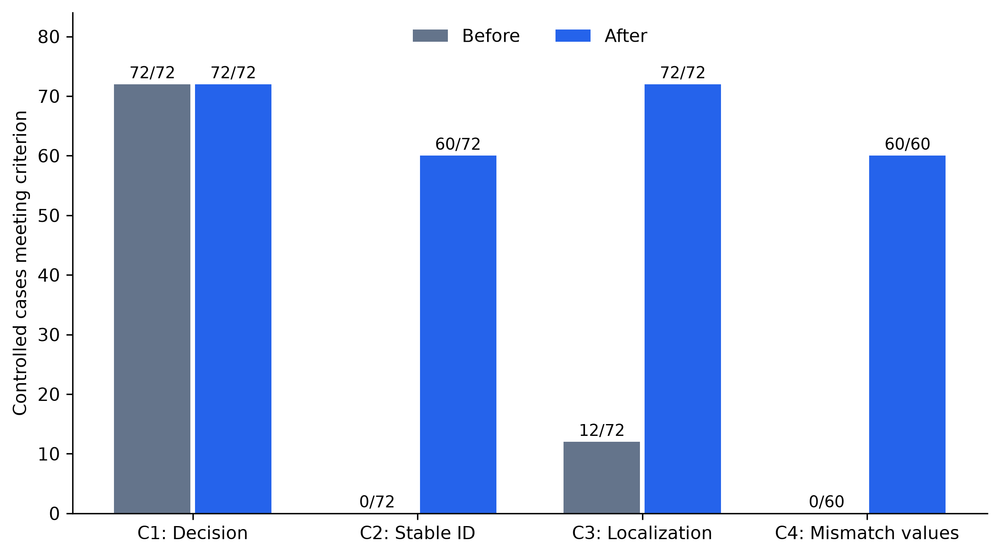
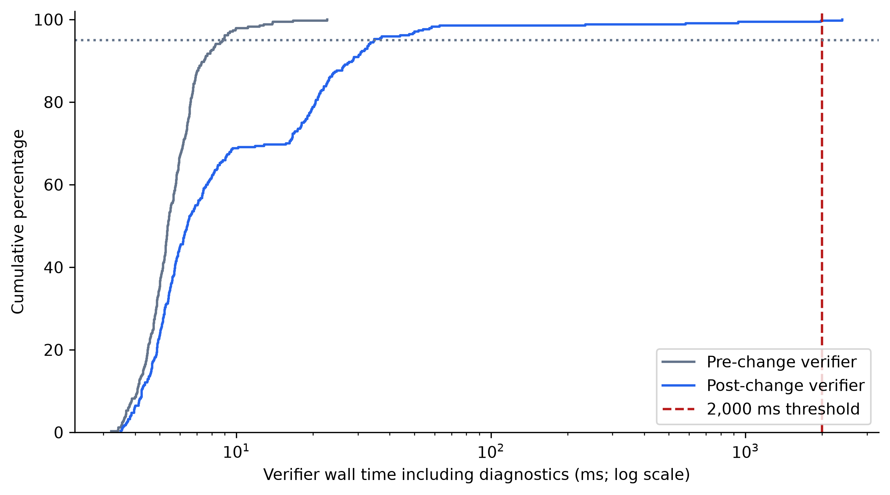

# Post-change graph-verification traceability report

Run completed: 2026-10-24T20:07:30.243551+00:00. This is a new implementation regression study, separate from all historical 400/600-prompt evaluations. No language-model benchmark, wallet operation or production graph refresh was run. References remain assistant-drafted; researcher review is not fabricated.

## Change and decision invariants

Non-approval results now expose stable decision/failure identifiers, specific observed entities or relationship endpoints, expected and observed values, and stored deployment/source/freshness/coverage context. Structured models validate the trace. Diagnostics use read-only Neo4j queries; there is no LLM inference. The pipeline forwards this metadata without changing interpretation or capability issuance.

The original swap/lending approval queries, knowledge-context query and freshness function are byte-for-byte/source-equivalent to the saved pre-change implementation. Approval payloads, excluding timing, matched exactly in the paired tests. Both REJECTED versus INSUFFICIENT_EVIDENCE selection and supported operations are preserved. An explanation-query failure returns unavailable diagnostics while retaining the already selected decision.

## Study design and preserved evidence

The exact historical 12 fixture specifications and five mutation types were reused: 12 valid controls plus 60 single-edge deletions. Each fixture preserves its entities/properties. Fresh fixture timestamps are synthesized test state, not a claim of official reacquisition. Mutations and lifecycle writes were confined to `thesis-eval-20261024`, guarded by an ownership marker. Production Neo4j node/relationship fingerprints match before and after; the fixture database was empty after cleanup.

Each case was run against the saved pre-change verifier and the final verifier. Order alternated to reduce systematic first-run bias. The independent latency phase used the existing 340 reference intents (112 distinct inputs), passed directly to the graph; no LLM outputs were needed. References were assigned from a read-only adjacency snapshot before calls and saved. Fourteen additional structured boundary cases were checked separately. The lifecycle regression repeated 12 knowledge conditions three times (36 calls per version). Every completed verifier call in this final comparative run was appended to a journal: 924 calls, with no duplicate phase/case/version keys. The two earlier implementation attempts each have their own 924-call journals, and the development probe has six calls; these are separate observations, not new independent cases.

## Decision regression results

| Workload | Cases per version | Before matches | After matches | Changed decisions |
| --- | --- | --- | --- | --- |
| D | 72 | 72 | 72 | 0 |
| E | 36 | 36 | 36 | 0 |
| graph | 340 | 340 | 340 | 0 |
| boundaries | 14 | 14 | 14 | 0 |

Selected reference-graph evidence matches: before 340/340, after 340/340. The admitted-snapshot graph references changed relative to the historical frozen graph reference in 0 cases. These are conformance checks, not independent protocol-truth certification.

## R5 audit: all 72 controlled relationship cases

| Criterion | Before | After |
| --- | --- | --- |
| C1_explicit_decision | 72/72 | 72/72 |
| C2_stable_rule_or_reason_identifier | 0/72 | 60/72 |
| C3_correct_specific_entity_or_broken_link | 12/72 | 72/72 |
| C4_expected_and_observed_mismatch_values | 0/60 | 60/60 |
| all_applicable | 0/72 | 60/72 |

Criteria follow the existing strict audit: C1 is a matching explicit decision; C2 is a stable machine-readable rule/reason identifier; C3 is correct selected approval evidence or the correct failed edge with both endpoints; C4 is the correct expected/observed mismatch. C4 is inapplicable to the 12 valid controls. The updated auditor reads the new nested schema and validates actual identities and values, rather than awarding a pass for field presence. Before and after responses were assessed by the same auditor.

Specific failed-edge localization succeeded for **60/60 mutations**. Unexpected witness count: **0**. For each localized deletion, expected presence is true, observed presence is false, relationship type and both endpoint identities match the deleted edge, and expected edge properties match the original fixture. `r5_audit_all_72.json` retains each comparison and both complete outputs. `before_after_example.json` illustrates EXPOSES_FUNCTION localization.

On the separate live reference workload, 128/140 non-approvals returned concrete observations and 12/140 reported `not_localized`; none reported unavailable diagnostics in the final run. A qualifying path was absent in those 12 cases, but no single-edge witness satisfied the remaining path constraints. No specific edge explanation was invented for them. This distinguishes complete localization in the controlled single-deletion fixtures from incomplete localization of general live path misses.

Approval responses were deliberately unchanged. Consequently the strict stable-rule-ID criterion remains unmet for the 12 approvals, even when their selected evidence and decisions match. Do not claim that all 72 cases satisfy every strict criterion. The original implementation's approval evidence is also not a complete explicit node-by-node path trace.

## Knowledge-maintenance regression

Both versions were tested on fresh/complete knowledge, stale knowledge, incomplete coverage with a missing path, deactivated membership, a failed refresh retaining a fresh accepted snapshot, and injected database unavailability. These are two protocol fixtures times six conditions times three repetitions. All expected dispositions are shown in the decision table. After-change source/coverage/failure-context checks matched in **36/36** records.

Staleness records the observed timestamp/age and configured maximum. Incomplete coverage retains INSUFFICIENT_EVIDENCE even when a missing edge is localized. Deactivation distinguishes an existing edge with `active=false` from an absent edge. Failed refresh continues to permit approval of the retained fresh/complete state, preserving the existing policy. Database unavailability is an injected exception, not a semantic rejection or a live outage measurement. Existing synchronization unit regressions also ran; acquisition/admission logic was not modified.

## Independent graph-verification latency

| Population / version | Calls | Within 2 s | Percent | p50 ms | p95 ms | Max ms |
| --- | --- | --- | --- | --- | --- | --- |
| independent_all_340 / before | 340 | 340 | 100.00% | 5.371 | 8.831 | 22.735 |
| independent_all_340 / after | 340 | 339 | 99.71% | 6.405 | 34.724 | 2397.972 |
| independent_first_distinct_112 / before | 112 | 112 | 100.00% | 5.271 | 8.831 | 13.906 |
| independent_first_distinct_112 / after | 112 | 111 | 99.11% | 8.429 | 58.469 | 2397.972 |
| independent_approvals / before | 200 | 200 | 100.00% | 5.345 | 8.854 | 22.735 |
| independent_approvals / after | 200 | 200 | 100.00% | 5.224 | 8.598 | 16.191 |
| independent_nonapprovals / before | 140 | 140 | 100.00% | 5.429 | 8.629 | 13.906 |
| independent_nonapprovals / after | 140 | 139 | 99.29% | 20.249 | 57.209 | 2397.972 |
| controlled_72 / before | 72 | 72 | 100.00% | 3.817 | 5.758 | 19.88 |
| controlled_72 / after | 72 | 71 | 98.61% | 14.586 | 215.621 | 2014.528 |

Timings are wall time around the verifier, including diagnostics and Neo4j work; LLM, wallet work and fixture setup are excluded. Quantiles use nearest rank. All first and slow calls are retained. First-distinct-input observations are not guaranteed cold-cache requests. Diagnostic queries were investigated/EXPLAIN-validated during development, and the same server previously ran the initial attempt; this is not a pristine cold-start benchmark. Separate approval/non-approval timing prevents diagnostic overhead from being hidden by fast approvals. R6 means at least 95% within two seconds, not a two-second maximum.

Slow independent calls: [{"id": "BAL600-115-B", "variant": "after", "latency_ms": 2397.972}]. The full per-call timings and order are in `regression_results.json`. These finite-workload observations do not establish a population latency guarantee or statistical significance. Paired formulations and shared graph inputs are dependent.

## Initial implementation attempt and recovery

The first implementation used a combined diagnostic query. In the isolated database it failed to localize the 60 mutations because its diagnostic work was unavailable; read-only investigation reproduced Neo4j client-configured transaction timeouts. Decisions remained unchanged. Its complete results, initial source version and a file-lock recovery checkpoint are preserved in `../traceability_post_change_2026-10-24/`. One early live diagnostic also returned unavailable; its original record did not capture a specific error code, so its exact cause is not asserted retrospectively.

The initial harness encountered a Windows atomic-replacement file lock after 104 graph pairs. All 208 calls were preserved in the journal and checkpoint, and continuation did not rerun them. Save retries were added to the harness. The final implementation instead stages the original MATCH clauses and performs smaller single-edge diagnostic checks, stopping at the first localized edge class. Diagnostic failure codes are now captured without exception messages. The final run is separate; the initial failed measurements have not been replaced or pooled with it.

An intermediate version using plain WITH boundaries localized 57/60 controlled mutations; three first-fixture explanations still timed out. Its independent graph workload met the numerical R6 threshold but included a 10,249.704-ms maximum, and its controlled workload achieved only 66/72 calls within two seconds. That complete attempt and its report are preserved in `../traceability_post_change_final_2026-10-24/`. The current revision uses WITH DISTINCT boundaries to prevent planning across the stages; duplicate-binding elimination preserves witness existence. A six-call development probe preceded this final run and is saved in `distinct_planner_probe.json`, including its 3663.377-ms maximum. Those probe calls are not additional independent test cases or part of the 340-reference workload. These development observations and prior server use limit cold-start claims; no slow measurement was deleted to improve a reported proportion.

## Tests and integrity

The final targeted pytest run passed 46 tests covering diagnostics, existing verifier semantics, synchronization, graph evaluation, pipeline handover, Aave preparation and slippage contracts. An existing Starlette/httpx deprecation warning was reported; dependencies were unchanged. Tests use mocks for pipeline/wallet contracts and do not establish live wallet protection. `unit_tests.xml` preserves the test report.

Integrity checks verified 346 pre-existing files. Only the authorized existing files `db/verifier.py` and `core/models.py` changed; the added diagnostic module, tests, documentation and report artifacts are new. Historical evaluation artifacts, intent processing/normalization, configuration and environment files remain unchanged. Original graph queries/freshness logic, all approved payloads and the production graph fingerprint were checked separately.

## Remaining limitations

- Localized witnesses describe candidate paths in admitted local knowledge. They do not establish independent protocol truth or necessarily the user's uniquely intended pool.
- At most five witnesses from the first localized edge check are returned. This is not exhaustive fault enumeration.
- Multiple simultaneous faults, missing node properties/metadata, or missing deployment context may remain unlocalized. Unknown values are retained as unknown rather than guessed.
- Diagnostic reads follow the decision read; concurrent graph updates can limit localization. No snapshot-isolation guarantee was added.
- Each explanation query has a two-second transaction timeout; this is not a two-second total request bound. Failures retain the decision and explicitly report unavailable diagnostics.
- The 60 mutations are five deletions across 12 fixture clusters. They do not test every wrong-edge substitution, adversarial graph or alternative-path configuration.
- The strict C2 approval limitation remains, and the frontend has not gained a new trace-rendering interface. Structured responses contain the trace.
- No claim about wallet readiness, balances, liquidity, collateral, debt or transaction success follows.

Reproduction: inspect the saved before/after source snapshots and references. `run_regression.py` refuses to overwrite completed results; a new run needs a separate directory and the original baseline. `analyse_report.py` recomputes the audit and report from saved records without model/database calls. The earlier 400/600-prompt evidence remains evidence of its original implementation, not of this changed verifier.
