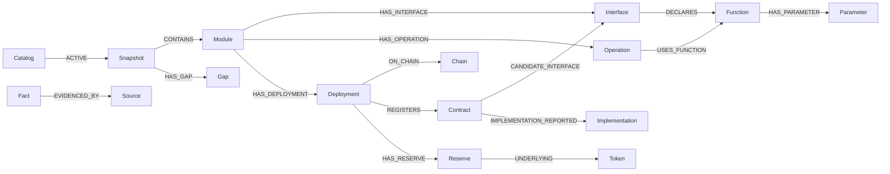

# Expanded protocol knowledge

This database describes protocol capabilities. It does not authorize transactions.
The existing verifier continues to use its original database and execution rules.

## Coverage contract

The first release covers **Aave V3, Aave Umbrella, and Uniswap V3** on Ethereum
mainnet and Ethereum Sepolia where official registries list deployments. Umbrella
on Base Sepolia is a different deployment; it is not evidence of Ethereum Sepolia
support. Other versions, networks, governance systems and ancillary modules are
recorded as gaps rather than silently treated as unsupported or complete.

| Module | Knowledge included | Execution in this prototype |
| --- | --- | --- |
| Aave V3 lending | Full selected ABIs, supply/withdraw/borrow/repay, permits, collateral controls, eMode, flash loans, liquidation, rewards, wrapped native token gateway, reads and administration | Existing four basic lending adapters only |
| Aave Umbrella | Core, stake token and rewards ABIs; staking, cooldown, redemption, rewards, reads and administration | No adapter yet |
| Uniswap V3 | Factory, pool, routers, quoter, position manager, migrator and tick lens ABIs; exact input/output swaps, liquidity positions, fee collection, quotes, reads and administration | Existing SwapRouter02 single-hop exact-input adapter only |
| Other versions/networks | Explicit coverage gaps and registry inventory | No new authorization |

“Full ABI” means every function, event and error in a particular pinned interface
source. It does not mean every historical implementation, every deployed pool,
or that a particular deployment implements the latest interface. The graph keeps
that distinction explicit. Unknown permissions remain `unreviewed`, not public.
Function parameters include tuple components, outputs and mutability. User-facing
operations have descriptions and prerequisites; these are not live eligibility checks.

## Model

All imported facts belong to an immutable `KnowledgeSnapshot`. A single
`KnowledgeCatalog` points to the active successful snapshot. Imports use an
explicit database name, reject existing unowned databases and publish atomically.
They never delete or edit the original graph or evaluation databases.



Contract/interface associations are **candidates** from registry roles, not
bytecode-level ABI verification. Optional RPC observations pin a block hash,
check the chain ID, record code presence and proxy slots, and read reserve/pool
state. They never turn a catalog fact into execution authority. Missing RPCs,
failed reads, and incomplete pool discovery are reported as coverage gaps.

Source downloads are pinned and bundled for offline replay. The bundle manifest
records source URLs, repository commits/package versions, retrieval times and
SHA-256 digests. Parsing treats source files as data and never executes them.

## Execution boundary

Three separate questions must be answered:

1. Does a pinned protocol interface describe the operation?
2. Does this prototype implement an adapter for that exact function and scope?
3. Does the current deployment and wallet satisfy the live conditions?

Only the existing verification and execution pipeline answers the third question.
The knowledge database returns `wallet_eligibility: not_evaluated` and never issues
an execution capability. A transfer is an ERC-20 operation, distinct from supply;
staking belongs to Umbrella, distinct from the Aave V3 lending pool.

## Sources

- [Aave address book](https://github.com/aave-dao/aave-address-book): addresses,
  reserve metadata and generated interface ABIs, pinned to a commit.
- [Aave V3 Pool documentation](https://aave.com/docs/aave-v3/smart-contracts/pool):
  lending semantics and prerequisites.
- [Aave Umbrella documentation](https://aave.com/docs/aave-v3/umbrella): staking
  module semantics and prerequisites.
- [Uniswap deployment registry](https://developers.uniswap.org/deployments.json):
  deployment roles and network identifiers, preserved by content hash.
- Official `@uniswap/v3-core`, `@uniswap/v3-periphery` and
  `@uniswap/swap-router-contracts` npm releases: compiled interface artifacts,
  pinned to package versions with registry integrity verification.

## Setup and inspection

Use the same Neo4j instance and credentials as the application. Creating an
additional database requires a Neo4j edition that supports multiple databases
and an account permitted to create databases. This workspace uses Neo4j Desktop
Enterprise. `KNOWLEDGE_DATABASE` defaults to `defi-knowledge-expanded`; the CLI
rejects the original, system and thesis database names.

```powershell
.\venv\Scripts\python.exe -m pip install -r requirements-knowledge.txt
# Build from the checked-in source bundle, without network access or DB writes:
.\venv\Scripts\python.exe -m knowledge build --output .cache/knowledge/catalog.json
# Create/publish the isolated database. Optional --rpc reads configured networks:
.\venv\Scripts\python.exe -m knowledge sync --rpc --output .cache/knowledge/import.json
# Read the published catalog:
.\venv\Scripts\python.exe -m knowledge summary
.\venv\Scripts\python.exe -m knowledge operations --module aave-umbrella --name stake
.\venv\Scripts\python.exe -m knowledge functions --module uniswap-v3 --name exactOutput
.\venv\Scripts\python.exe -m knowledge contracts --module aave-v3
.\venv\Scripts\python.exe -m knowledge gaps --limit 200
```

The sync command hashes all online non-knowledge databases before and after
publication and records the comparison in its output. Re-importing the identical
graph reuses its snapshot. A changed block or source creates a new immutable
snapshot. Failed builds/imports leave the active snapshot intact. Historical
snapshots are retained; no automatic cleanup deletes them.

After starting the existing API (`uvicorn api.app:app --reload --port 8000`), open
[the knowledge browser](http://127.0.0.1:8000/knowledge). It supports module/name
filters and pagination. The chat's execution scope is unchanged.

Try these browser searches:

| Show | Module | Search | Expected result |
| --- | --- | --- | --- |
| Operations | Aave Umbrella | stake | Stake and unstake, with cooldown/asset conditions; knowledge only |
| Operations | Aave V3 lending | borrow | Lending operation with collateral and reserve prerequisites |
| Operations | Uniswap V3 | borrow | No ordinary lending operation |
| Operations | Uniswap V3 | liquidity | Position and pool liquidity operations |
| Functions | Uniswap V3 | exactOutput | Single-hop and multihop exact-output interfaces |
| Functions | Aave V3 lending | setSupplyCap | Privileged configurator function |
| Operations | Aave V3 lending | transfer | aToken transfer, distinct from supply |
| Gaps | All modules | (empty) | Missing network, interface and live-state evidence |

Read-only JSON endpoints:

- `/api/knowledge/summary`
- `/api/knowledge/operations?module=aave-umbrella&name=stake`
- `/api/knowledge/functions?module=uniswap-v3&name=exactOutput&limit=100&offset=0`
- `/api/knowledge/contracts?module=aave-v3`
- `/api/knowledge/gaps`

## Neo4j Browser examples

Select the database with `:use defi-knowledge-expanded`. Always follow the active
snapshot so older imports are not counted twice.

```cypher
MATCH (:KnowledgeCatalog)-[:ACTIVE]->(s)-[:CONTAINS]->(m:Module)
MATCH (m)-[:HAS_OPERATION]->(o:Operation)-[:USES_FUNCTION]->(f:Function)
RETURN m.name, o.action, f.signature, f.prototype_adapter_implemented
ORDER BY m.name, o.action;
```

```cypher
MATCH (:KnowledgeCatalog)-[:ACTIVE]->(s)-[:CONTAINS]->(d:Deployment)
MATCH (d)-[:REGISTERS]->(c:Contract)-[:EVIDENCED_BY]->(source:Source)
OPTIONAL MATCH (c)-[:CANDIDATE_INTERFACE]->(i:Interface)
RETURN d.module, d.chain_id, c.role, c.address, i.name, source.url;
```

```cypher
MATCH (:KnowledgeCatalog)-[:ACTIVE]->(s)-[:CONTAINS]->(g:CoverageGap)
RETURN g.scope, g.code, g.detail;
```

## Refresh and validation

`python -m knowledge refresh-sources` is an explicit source refresh. Review and
commit the updated `data/sources.lock.json` and `data/sources.zip`, then rebuild.
Ordinary builds never silently pull newer sources. All bundled upstream license
notices are retained in the archive. Deployment feed bytes are content-pinned;
the feed's reported repository commit is recorded as metadata, not independently
asserted to reproduce the feed.

`--rpc` uses `MAINNET_RPC` and `SEPOLIA_RPC` without exporting their values. All
calls are read-only, chain IDs are checked, and the block hash is checked again
after observations. Pool discovery is intentionally bounded (`--pool-limit`,
default 80 pair/fee lookups per network); it does not scan every factory event.
Reserve configuration observations include raw ABI data and a conservative subset
of stable V3 fields. They are historical observations, not live transaction checks.

```powershell
.\venv\Scripts\python.exe -m pytest tests/test_knowledge_catalog.py tests/test_knowledge_database.py tests/test_knowledge_api.py -q
# Optional live transaction rollback/idempotency check; temporary writes roll back:
$env:KNOWLEDGE_INTEGRATION = '1'
.\venv\Scripts\python.exe -m pytest tests/test_knowledge_database.py tests/test_knowledge_api.py -q
Remove-Item Env:KNOWLEDGE_INTEGRATION
```

Next coverage extensions should pin additional module interfaces/deployments,
review their permissions and conditions, and close named gaps. New wallet
adapters require separate verification, encoding, simulation and policy work.

## Initial populated snapshot

The checked-in [coverage report](data/coverage-report.json) records the initial
reviewed import: 23 interfaces, 548 functions, 142 events, 83 errors, 36 operation
groups, 76 Aave reserve listings, four Umbrella vaults and 35 observed Sepolia
pools. Contract/token counts represent contextual records, not distinct addresses.
Sepolia observations are pinned to block 12021347. Mainnet has registry evidence
only because `MAINNET_RPC` was not configured. Twenty explicit coverage gaps
remain; this is not a claim of every Aave/Uniswap version or network being complete.

The report includes matching before/after fingerprints for the existing `neo4j`
and both thesis evaluation databases. Unit, regression and live checks cover
source integrity, ABI selectors/overloads, isolated database naming, read-only
RPC, chain mismatch, reorg rejection, failed-import rollback, idempotency,
catalog pagination and page rendering.
